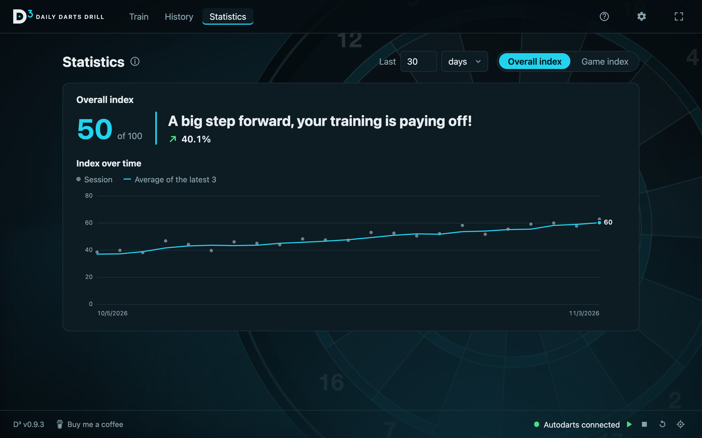
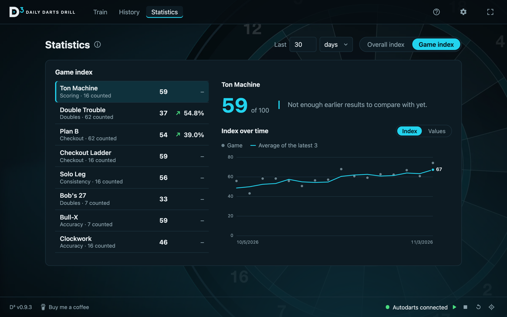
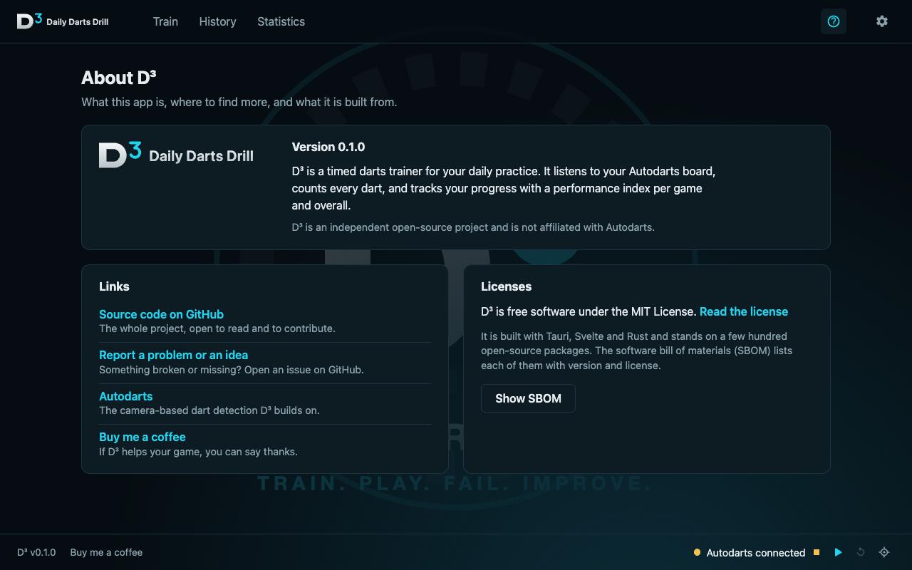
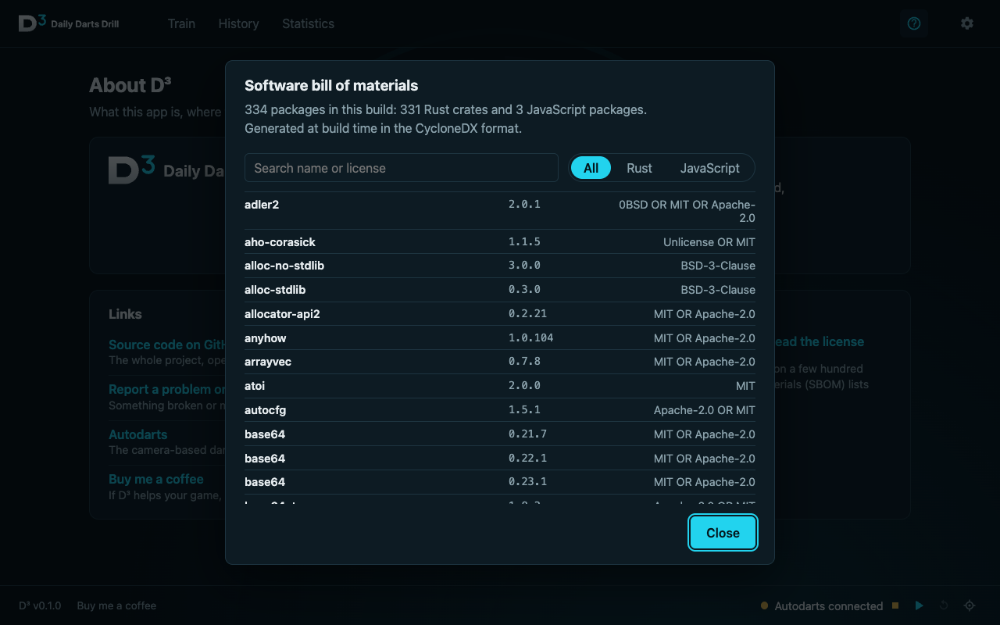

# D³ – Daily Darts Drill

**TRAIN. PLAY. FAIL. IMPROVE.**

D³ is a desktop app for structured, daily darts practice. You put together a training routine from a set of
drills, give every drill a time cap, and throw. An automatic scoring system counts every dart, and D³ turns
the results into a performance index that shows whether your training is paying off.

D³ is an independent open-source project and is not affiliated with any autoscoring system.

## Why I built this

I want to get better at darts, and for me that means training on purpose, not just playing. Auto-scorers come with
training games. What they don't do is track whether systematic training actually moves you forward.

So I started doing it by hand. I'd play a training game, pause to write down the result, and put everything into a
spreadsheet afterwards. It worked, but it was nerve-racking: every pause broke my rhythm, and none of it was fun or
motivating. On top of that, some of the games I like most weren't supported at all.

D³ is the tool I wanted back then. You put together a routine from the drills you care about, start it, and just
throw. The app keeps the time, counts every dart through Autodarts and saves the results. Over time you see how
you're actually progressing.

**What D³ is, and what it isn't:**
- It's a training companion for practising alone at your board, with an Autodarts setup.
- It isn't a match platform, an online league or a replacement for the Autodarts app.
- It's a hobby project that I build for my own training. It grows with what I need, so expect rough edges and changes.

## Features

### Training routines

A routine is your daily drill: a list of games, each with its own settings and a time cap, and a short break
between them. Pick a routine from the carousel and start it. Routines are easy to build and change: add games,
reorder them by drag & drop, set the break between games. A game that ends by itself (Solo Leg with a number of
legs, Clockwork, Bob's 27, Catch 40) can run without a time cap.

Two routines come with D³, so you can start training right away. They are normal routines: change them or delete
them, and "Restore built-in routines" in the settings brings them back.

| Routine | What is in it |
|---|---|
| **Everyday Drill** (about 77 min) | Loose Arm, Clockwork, Double Trouble and Plan B on D20, D16 and D18, Ton Machine, Checkout Ladder, finishing with four real legs of Solo Leg. |
| **Intense Doubles** (about 45 min) | Loose Arm, Bull-X, Double Trouble and Plan B on D20 and D16, and one round of Bob's 27. |

### Quick games

No time for a full routine? Play a single game with or without a time cap. D³ remembers what you played last.

The games so far:

| Game | What it is | Why play it |
|---|---|---|
| **Loose Arm** (warm up) | Throw freely. No result, the clock just keeps the routine on schedule. | Loosen your arm and find your rhythm before the drills that count. |
| **Clockwork** (around the clock) | Hit every number in board order, then finish on the bull. | Accuracy all over the board, not just on the 20. |
| **Double Trouble** (simple doubles) | Throw at one double, only that double counts. | Makes your favourite double automatic. |
| **Plan B** (complex doubles) | Check out the double over three darts. Single hits are subtracted and the next target follows from what is left. | Recovering when the first dart misses. |
| **Ton Machine** (scoring) | Your score per three darts is the number that counts. | A steady, heavy scoring rhythm. |
| **Checkout Ladder** (121) | Check out within 9 darts. A checkout raises the next one, a miss lowers it. | Finishing under pressure, and it gets harder the better you get. |
| **Catch 40** | Check out every number from 61 to 100 in order, six darts each. 3 points for two darts, 2 for three, 1 for four to six. | Pressure checkouts in the range that decides most legs. |
| **Wild Card** (random checkout) | A random checkout from the range you pick, with 3, 6 or 9 darts. No checkout twice before the whole range has come up. | Reading any finish quickly. |
| **Bob's 27** | Start with 27 points and go round D1 to D20 and the bull, three darts each. Hits add the double's value, a miss with all three subtracts it. | Doubles with something at stake. |
| **Bull-X** (bullseye drill) | Dart 1 goes at the bull; hit it and darts 2 and 3 stay there. Miss and they go at the double, treble or (Shanghai) the other two parts of the segment dart 1 hit. | Pressure on the bull, and a way back when it isn't there. |
| **Big Fish** (170) | Leg after leg from 170, double out, bust is no score. | The high finishes and the nerve for them. |
| **Solo Leg** (solo 501) | A normal leg against yourself (301, 501 or 701): 3-dart and first-9 average, checkout rate. | Your whole game in one number. |

The checkout games show the usual route under the rest and light the first field on the board (switch it off
with "Show route").

### Live board

While you play, D³ shows every dart on the board as it lands, with the score of the current turn and the
game's numbers next to it. Corrections in the autoscorer are picked up. Pause, skip a game or stop at any time.

### Performance index

The **D³ Performance Index (DPI)** rates every result from 0 to 100 against a target per game: 100 means you
reached the target, not that you were perfect. The overall index combines your games. For any period you get
your level, the trend against the period before, and the chart over time.

Each game has its own index, and the chart switches between the index and the game's own values,
like the 3-dart average.

### History

Every session, filtered by period and by routines or quick games, with its index. The details show each game
with its result. Deleting a session updates the index, so D³ asks first.

### Settings

D³ finds your autoscorer in the local network by itself. You can also search for it, or enter the address by
hand. The connection card shows whether the detection is running, and the footer lets you start and stop the
detection, reset the board and calibrate the cameras without leaving D³. The app speaks English and German.

### Your data

Once a day, when D³ starts, it copies your data (the last 5 copies are kept), and it takes a copy before the
first start of a new version. "Your data" in the settings shows the last backup, opens the backup folder and
exports everything into one file you can keep on a USB stick or take to a new computer. If a start goes wrong,
D³ writes a short log (`d3.log`) and, for every error it didn't expect, a crash report; "Report on GitHub" opens
an issue with the details filled in. Nothing leaves your computer by itself.

### Updates

D³ looks for a newer version when it starts (once a day) and tells you with a small dot on the settings icon.
You decide when to install it, never during a routine. The check reads one small file (`latest.json`) from this
GitHub project and sends nothing about you; you can switch it off in the settings, the manual button always
works. Updates are signed, so only versions from this project install. Your data is backed up before the update.

### About & SBOM

The About page links to the project and lists every open-source package in the app, with version and license,
in a software bill of materials (CycloneDX) that is generated with every build.

## Supported autoscorers

| System | Status |
|---|---|
| [Autodarts](https://autodarts.io) | ✅ Supported |

D³ talks to the **Autodarts client** in your local network (port `3180` by default): it reads the live event
stream (`ws://<host>:3180/api/events/system`) and uses its local API to start and stop the detection, reset
the board and calibrate. D³ itself needs no Autodarts login and no internet connection. The client announces
itself on the network (mDNS), which is how D³ finds it on its own.

Using another system? Open an [issue](https://github.com/sbforge/daily-darts-drill/issues),
support for more autoscorers is welcome.

## Install

Download the installer for your system from the
[releases](https://github.com/sbforge/daily-darts-drill/releases):

| System | File |
|---|---|
| Windows 10/11 | `Daily Darts Drill_<version>_x64_en-US.msi` |
| macOS, Apple Silicon (M1 and later) | `Daily Darts Drill_<version>_aarch64.dmg` |
| macOS, Intel | `Daily Darts Drill_<version>_x64.dmg` |
| Linux (x86-64) | `Daily Darts Drill_<version>_amd64.AppImage` (updates itself) or `…_amd64.deb` (updated by hand) |

The builds are not signed with a paid certificate, so your system will warn you the first time:

- **Windows:** SmartScreen says "Windows protected your PC". Click "More info", then "Run anyway".
- **macOS:** drag D³ into the Applications folder and open it. macOS says it can't verify the app:
  open **System Settings → Privacy & Security**, scroll down to the message about D³ and click **Open Anyway**
  (on macOS Sequoia a right-click → Open no longer works). If macOS says the app is "damaged", run
  `xattr -dr com.apple.quarantine "/Applications/Daily Darts Drill.app"` in the Terminal once.
  Keep D³ in the Applications folder: an app opened from the disk image or the Downloads folder can't update itself.
- **Linux:** make the AppImage executable (`chmod +x`) and run it. Keep it in a folder you can write to, such as
  `~/Applications`, or it can't replace itself when it updates. The `.deb` installs like any other package
  (`sudo apt install ./<file>.deb`).

**The first version with updates must be installed by hand;** from then on D³ offers new versions itself.

### Where your data lives

All data stays on your computer, in a SQLite database in your user folder. Updating or reinstalling D³ keeps it.
Backups are in the `backups` folder next to it, and the log and crash reports in D³'s log folder
(About → "Open log folder").

| System | Location of `darttrainer.db` |
|---|---|
| Windows | `C:\Users\<name>\AppData\Roaming\dev.darttrainer.app\` |
| macOS | `~/Library/Application Support/dev.darttrainer.app/` |
| Linux | `~/.config/dev.darttrainer.app/` |

**Restoring a backup:** close D³, then copy the files from a folder in `backups` (`darttrainer.db` and, if there,
`darttrainer.db-wal`) over the ones in the data folder.

## Development

Built with Tauri 2, Svelte 5, TypeScript and Rust. Runs on Windows, macOS and Linux.

1. Install Node 20+ and Rust, plus the Tauri system prerequisites for your OS:
   https://v2.tauri.app/start/prerequisites/
2. `npm install`
3. `npm run tauri dev` to develop, `npm run tauri build` for an installer, `npm test` for the tests (vitest, and `cargo test` in `src-tauri`)
4. `npx tauri icon src-tauri/icons/app-icon.png` regenerates all app icons in `src-tauri/icons` from the D³ artwork

The app must run inside Tauri (`npm run tauri dev`): the database only exists there.

### Where things live

- `src/App.svelte`: the screens (training, history, statistics, settings, about)
- `src/lib/autodarts.ts`: websocket client and the normalizer that turns raw `state` messages into dart events
- `src/lib/discovery.ts`, `src-tauri/src/main.rs`: finding the Autodarts client via mDNS
- `src/lib/games/`: the games, one module each. Each one is a pure function from turns and settings to stats, so it is easy to add more
- `src/lib/dpi.ts`: the performance index, always worked out from the stored results
- `src/lib/db.ts`: the SQLite database (settings, routines, sessions, game results, raw darts); the schema is in `src-tauri/migrations/`, one numbered file per change
- `src/lib/session.svelte.ts`: one run of one game
- `src/lib/Board.svelte`: live dartboard from the throw coordinates
- `src/lib/i18n/`: English and German texts
- `scripts/sbom.js`: the SBOM, written into every build as `sbom.json`
- `.github/workflows/`: `ci.yml` checks every pull request; `release.yml` builds all installers into a draft release when a `v*` tag is pushed
- `docs/`: the plans behind the features, `docs/v1-scope.md` is the checklist, `docs/v1-assumptions.md` lists the guesses made for v1

### Releasing

`package.json` holds the version. `npm version 1.0.0` updates `Cargo.toml` and `Cargo.lock`, commits and tags;
`git push --follow-tags` starts the build, which fills a **draft** release. Check it, then publish it.
A tag with a dash (`v1.1.0-beta.1`) is a pre-release that updating apps are not offered.
The updater signing key is a repository secret (`TAURI_SIGNING_PRIVATE_KEY`, `TAURI_SIGNING_PRIVATE_KEY_PASSWORD`).

### Good to know

- Aborting a routine (or closing the app during one) records it as "Aborted" and keeps no scores for that run.
- Pausing freezes the clock; throws made while paused are not counted.

## License

[MIT](LICENSE)
