# D³ – Daily Darts Drill

**TRAIN. PLAY. FAIL. IMPROVE.**

D³ is a desktop app for structured, daily darts practice. You put together a training routine from a set of
drills, give every drill a time cap, and throw. An automatic scoring system counts every dart, and D³ turns
the results into a performance index that shows whether your training is paying off, and into a precision view
that shows where your darts land around the field you aimed at.

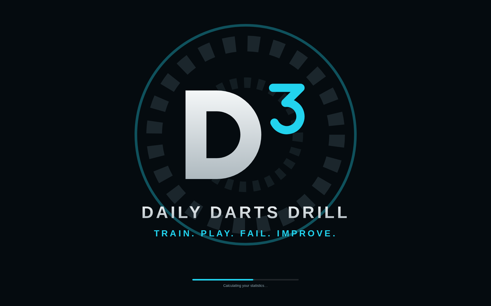

D³ is an independent open-source project and is not affiliated with any autoscoring system.

## Why I built this

I want to get better at darts, and for me that means training on purpose, not just playing. Auto-scorers come with
training games. What they don't do is track whether systematic training actually moves you forward.

So I started doing it by hand. I'd play a training game, pause to write down the result, and put everything into a
spreadsheet afterwards. It worked, but it was nerve-racking: every pause broke my rhythm, and none of it was fun or
motivating. On top of that, some of the games I like most weren't supported at all.

D³ is the tool I wanted back then. You put together a routine from the drills you care about, start it, and just
throw. The app keeps the time, counts every dart through Autodarts and saves the results. Over time you see how
you're actually progressing.

**What D³ is, and what it isn't:**
- It's a training companion for practising alone at your board, with an Autodarts setup.
- It isn't a match platform, an online league or a replacement for the Autodarts app.
- It's a hobby project that I build for my own training. It grows with what I need, so expect rough edges and changes.

## Features

### Training routines

A routine is your daily drill: a list of games, each with its own settings and a time cap, and a short break
between them. Pick a routine from the carousel and start it. Routines are easy to build and change: add games,
reorder them by drag & drop, set the break between games. A game that ends by itself (Solo Leg with a number of
legs, Clockwork, Bob's 27, Catch 40) can run without a time cap; the JDC Challenge never has one, so its results stay comparable.

Two routines come with D³, so you can start training right away. They are normal routines: change them or delete
them, and "Restore built-in routines" in the settings brings them back.

Routines can be passed on: the export icon in the routine editor saves one as a small file
(`<name>.d3-routine.json`), and "Import" on the start page adds it to someone else's D³. Only the routine goes in
the file (name, description, break, the games and their settings), none of your results.

| Routine | What is in it |
|---|---|
| **Everyday Drill** (about 80 min) | Warmup, Clockwork, Double Trouble and Plan B on D20, D16 and D18, Ton Machine, Checkout Ladder, finishing with four real legs of Solo Leg. |
| **Intense Doubles** (about 45 min) | Warmup, Bull-X, Double Trouble and Plan B on D20 and D16, and one round of Bob's 27. |

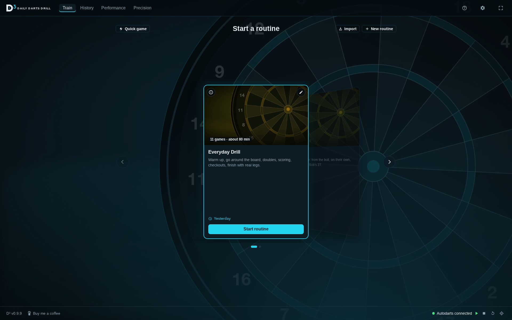

### Quick games

No time for a full routine? Play a single game with or without a time cap. D³ remembers what you played last.

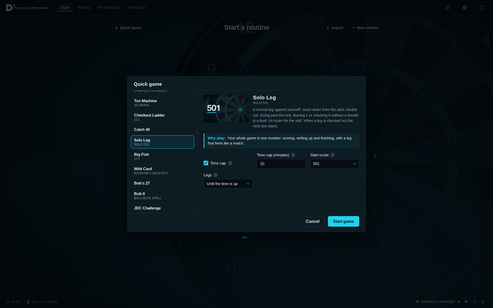

The games so far:

| Game | What it is | Why play it |
|---|---|---|
| **Warmup** | Throw freely. No result, the clock just keeps the routine on schedule. | Loosen your arm and find your rhythm before the drills that count. |
| **Clockwork** (around the clock) | Hit every number in board order, then finish on the bull. | Accuracy all over the board, not just on the 20. |
| **Double Trouble** (simple doubles) | Throw at one double, only that double counts. | Makes your favourite double automatic. |
| **Plan B** (complex doubles) | Check out the double over three darts. A hit halves the double for the next dart (D20, D10, D5), a miss counts off what is left, a bust starts over. Every dart has a target. | Recovering when the first dart misses. |
| **Ton Machine** (scoring) | Your score per three darts is the number that counts; every visit is counted in its band (60+, 100+, 140+, 180 …). | A steady, heavy scoring rhythm. |
| **Checkout Ladder** (121) | Check out within 9 darts. A checkout raises the next one, a miss lowers it. | Finishing under pressure, and it gets harder the better you get. |
| **Catch 40** | Check out every number from 61 to 100 in order, six darts each. 3 points for two darts, 2 for three, 1 for four to six. | Pressure checkouts in the range that decides most legs. |
| **Wild Card** (random checkout) | A random checkout from the range you pick, with 3, 6 or 9 darts. No checkout twice before the whole range has come up. | Reading any finish quickly. |
| **Bob's 27** | Start with 27 points and go round D1 to D20 and the bull, three darts each. Hits add the double's value, a miss with all three subtracts it. | Doubles with something at stake. |
| **Bull-X** (bullseye drill) | Dart 1 goes at the bull; hit it and darts 2 and 3 stay there. Miss and they go at the double, treble or (Shanghai) the other two parts of the segment dart 1 hit. | Pressure on the bull, and a way back when it isn't there. |
| **JDC Challenge** | Three parts: Shanghai 10–15 (every hit on the number scores, a Shanghai is 100 extra), one dart at each double from D1 to the bull (50 each, 100 for the bull), then Shanghai 15–20. 1 to 5 rounds of 57 darts (at most 3380 points each), always played to the end without a time cap. | Scoring numbers, doubles and the bull in one comparable score. |
| **Big Fish** (170) | Leg after leg from 170, double out, bust is no score. | The high finishes and the nerve for them. |
| **Solo Leg** (solo 501) | A normal leg against yourself (301, 501 or 701), leg after leg or a set number of legs: match and leg average side by side. | Your whole game in one number. |

> **A note on the games:** Some of these games come from classic darts drills, and I know the original rules. Where this app plays them differently, that is on purpose: these are the variations I like to practise myself. Different from what you are used to? [Open an issue](https://github.com/sbforge/daily-darts-drill/issues) and tell me. I'm happy to add more games or more variants.

### Live board

While you play, D³ shows every dart on the board as it lands, with the score of the current turn and the
game's numbers next to it. A dart that misses the board shows where, as in Autodarts: M4 is a miss beside the 4.
Pause, skip a game or stop at any time; the button beside the dart boxes ends a turn early and clears the board in
Autodarts as well.

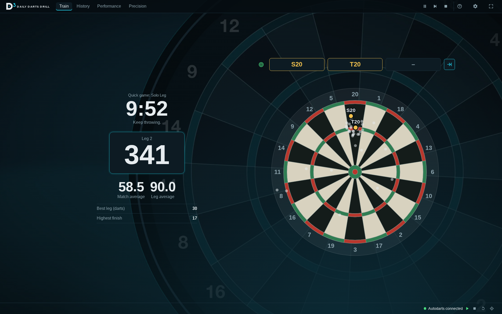

**Correcting a dart:** corrections in Autodarts are picked up, and you can correct a dart in D³ too. Click its dart
box: the fields touching the one counted appear as buttons under the dart boxes (for S20 that is T20, D20, S1 and
S5), because the cameras are mostly off by a few millimetres only. One click and the dart is corrected. Anything
further away you click on the board; a light ring around it marks where a click counts as a miss.

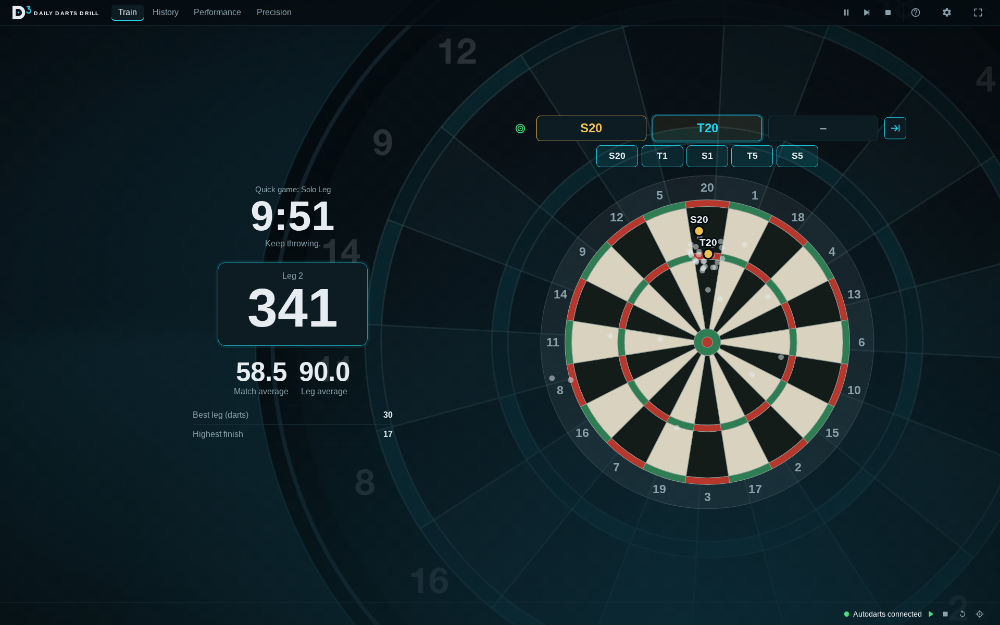

**Game shot:** in the games you check out in (Solo Leg, Big Fish, Checkout Ladder, Catch 40, Wild Card), a checkout
locks the board until you pull your darts. Darts thrown after a checkout or a bust don't count and aren't shown;
the next leg or checkout starts after the takeout. The JDC Challenge does the same at the end of each round and
shows the round's result over the board: the points, the three parts, your Shanghais and the doubles you hit.

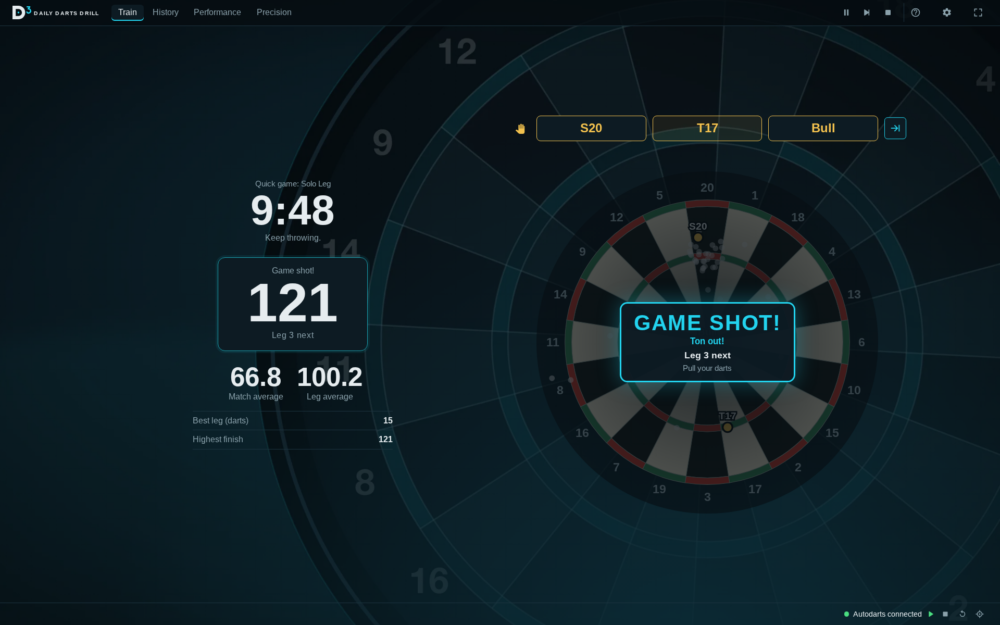

**Counting the score:** in the games that count a rest down, the rest changes when your visit is over, as in a
match where nobody does the sums for you. Settings → Playing switches to counting after every dart. A bust or a
checkout always shows at once.

### Performance

The **D³ Performance Index (DPI)** rates every result from 0 to 100 against a target per game: 100 means you
reached the target, not that you were perfect. The overall index combines your games. For any period you get
your level, the trend against the period before, and the chart over time.

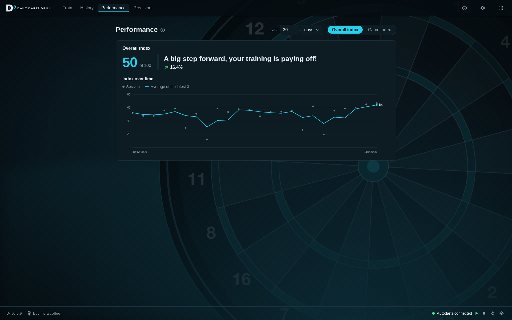

Each game has its own index, and the chart switches between the index and the game's own values,
like the 3-dart average. How many results each comparison uses is up to you: Settings → Performance.

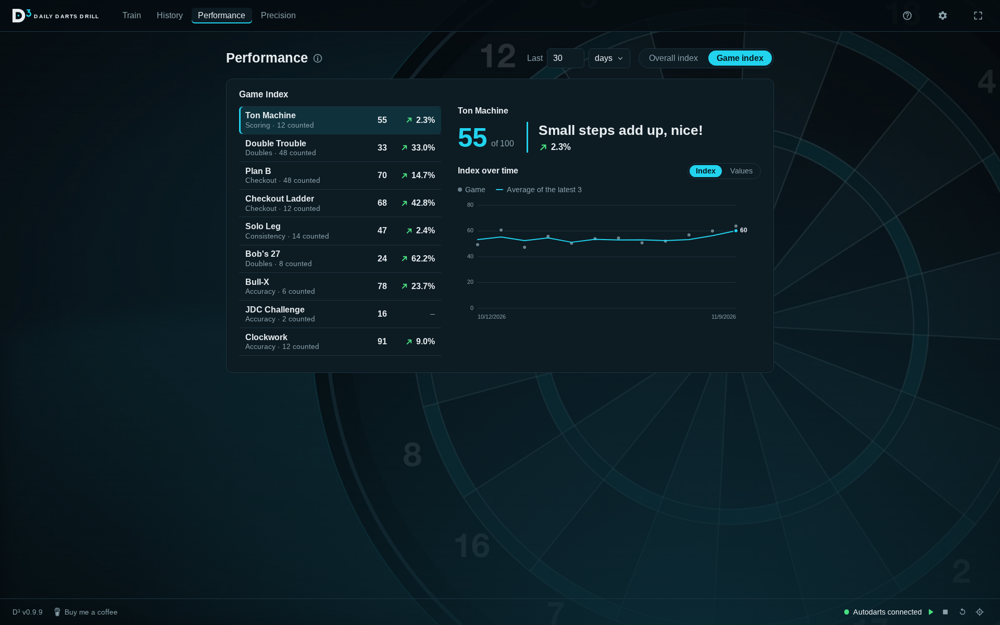

### Precision

How close do you land to the centre of the field you aimed at? The Precision tab measures it for every dart thrown
at a target the game fixes: Clockwork, the doubles games, Bob's 27, Bull-X and the doubles of the JDC Challenge. It
shows the average distance in mm, your tendency (e.g. "3 mm low · 1 mm left"), how widely you scatter and how often
you were in the field, with a short line on what each of them means and a box that sums up what to work on.
Nothing needs to be set up: every game you have played counts.

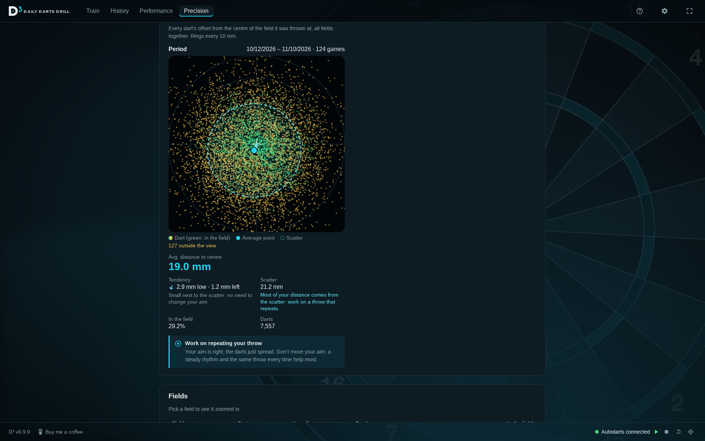

Pick all fields, a kind of field (all doubles, all trebles, …) or a single field such as D16: it is drawn zoomed
in, with every dart on it and your average point. Tick *Compare with another period* to see two periods side by
side. A dart more than 8 cm from the centre of its field wasn't really thrown at it and is left out, and so is a
dart you set or corrected by hand. Below 30 darts on a field D³ shows the figures, but says how many darts are
still missing for a reliable suggestion.

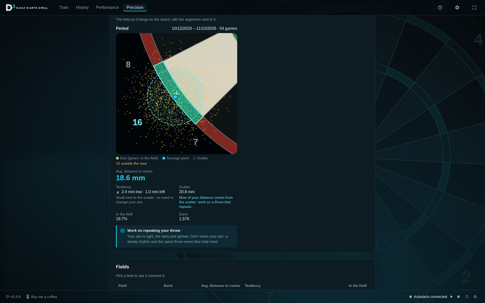

### History

Every session, filtered by period and by routines or quick games, with its index. The details show each game
with its result. Deleting a session updates the index, so D³ asks first.

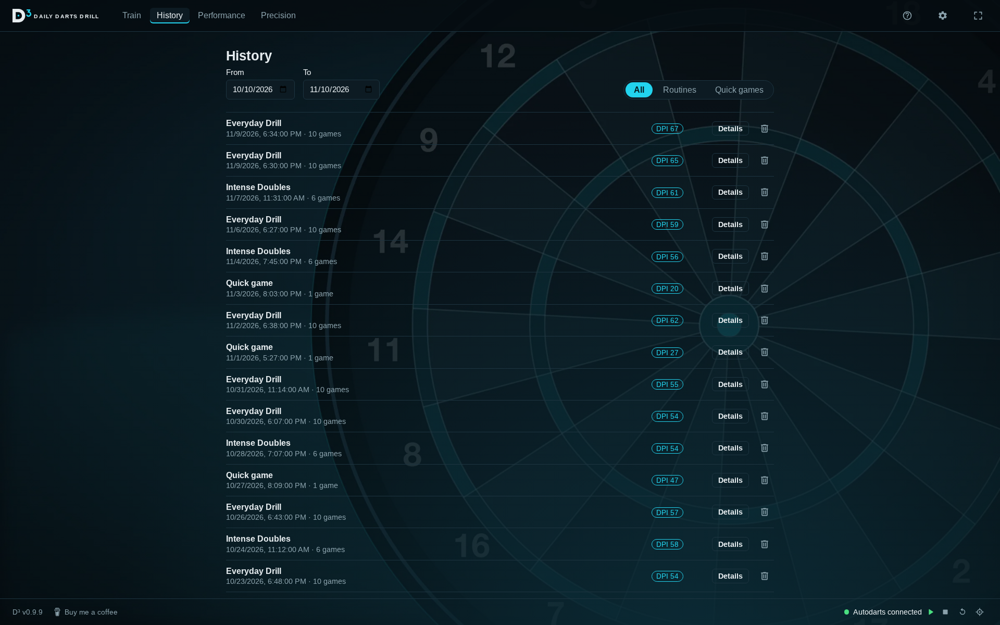

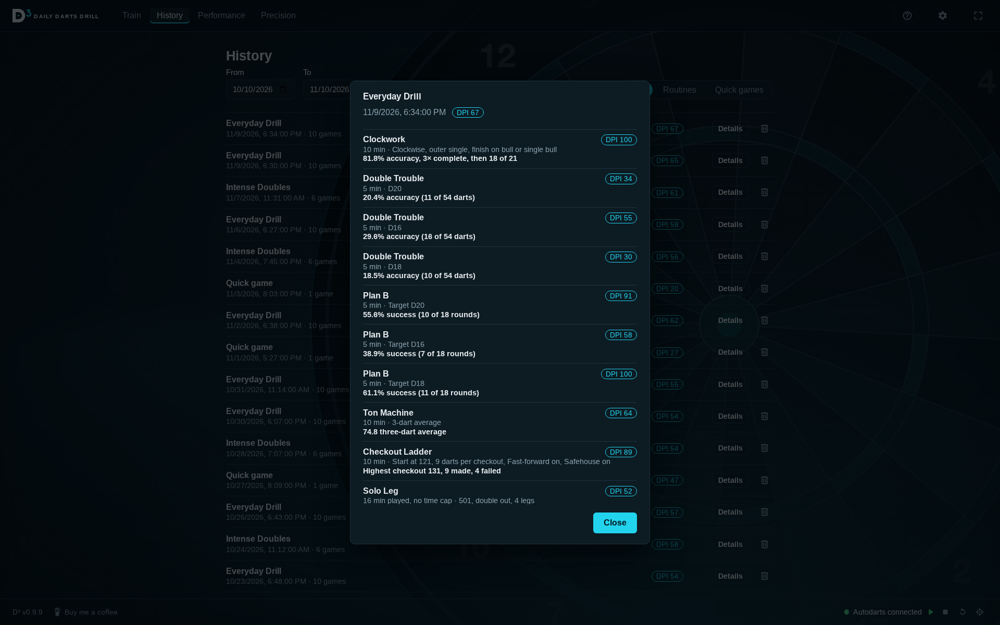

### Settings

D³ finds your autoscorer in the local network by itself. You can also search for it, or enter the address by
hand. The connection card shows whether the detection is running and the last darts it saw, and the footer lets
you start and stop the detection, reset the board and calibrate the cameras without leaving D³. A routine or quick
game that counts darts only starts while D³ is connected. Below the connection: the language (English and German),
animations, how the score is counted, and how many results each Performance comparison uses.

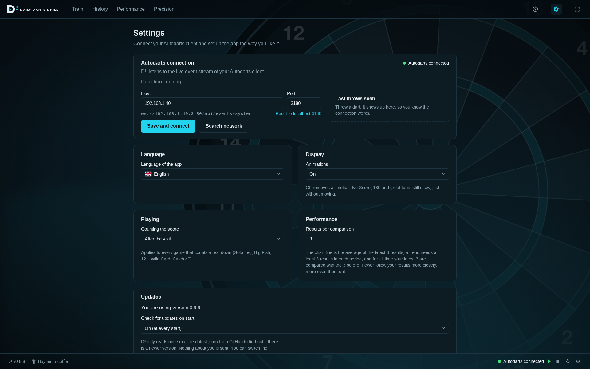

### Your data

Once a day, when D³ starts, it copies your data (the last 5 copies are kept), and it takes a copy before the
first start of a new version. "Your data" in the settings shows the last backup, opens the backup folder and
exports everything into one file you can keep on a USB stick or take to a new computer. "Restore a backup…"
goes back to one of the backups or to an exported file: D³ checks it, saves your current data first and restarts
with it. "Erase all data", the
last button in the settings, starts over with the built-in routines; it asks twice and keeps one copy in the
backup folder. If a start goes wrong,
D³ writes a short log (`d3.log`) and, for every error it didn't expect, a crash report; "Report on GitHub" opens
an issue with the details filled in. Nothing leaves your computer by itself.

### Updates

D³ looks for a newer version at every start, in the background, and shows an "Update" button in the top bar when there is one. Offline it just stays quiet.
You decide when to install it, never during a routine. The check reads one small file (`latest.json`) from this
GitHub project and sends nothing about you; you can switch it off in the settings, the manual button always
works. Updates are signed, so only versions from this project install. Your data is backed up before the update.

Want to try new versions before they are released? Settings → Developer → developer mode lets you pick the
*Preview* channel, which also offers beta versions. Only do this if you don't mind rough edges: a beta can still
have mistakes and may change your data so that released versions can't read it any more.

## Supported autoscorers

| System | Status |
|---|---|
| [Autodarts](https://autodarts.com) | ✅ Supported |

D³ talks to the **Autodarts client** in your local network (port `3180` by default): it reads the live event
stream (`ws://<host>:3180/api/events/system`) and uses its local API to start and stop the detection, reset
the board and calibrate. D³ itself needs no Autodarts login and no internet connection. The client announces
itself on the network (mDNS), which is how D³ finds it on its own.

Using another system? Open an [issue](https://github.com/sbforge/daily-darts-drill/issues),
support for more autoscorers is welcome.

## Install

D³ runs on **Windows, macOS and Linux**. Download the file for your system from the
[latest release](https://github.com/sbforge/daily-darts-drill/releases/latest):

| System | File |
|---|---|
| Windows 10 and 11 (64-bit) | `Daily Darts Drill_<version>_x64-setup.exe` |
| macOS, Apple Silicon (M1 and later) | `Daily Darts Drill_<version>_aarch64.dmg` |
| macOS, Intel | `Daily Darts Drill_<version>_x64.dmg` |
| Linux (x86-64) | `Daily Darts Drill_<version>_amd64.AppImage` (updates itself) or `…_amd64.deb` (updated by hand) |

You also need an [Autodarts](https://autodarts.com) board whose client runs in the same network (see
[Supported autoscorers](#supported-autoscorers)).

The installers are not signed with a paid certificate, so your system warns you the first time:

- **Windows:** run the `-setup.exe`. SmartScreen says "Windows protected your PC": click "More info", then "Run anyway".
  D³ installs for your Windows user only, so it doesn't ask for administrator rights, neither now nor on updates.
- **macOS:** open the `.dmg` and drag D³ into the Applications folder, then open it there. macOS says it can't verify
  the app: open **System Settings → Privacy & Security**, scroll down to the message about D³ and click **Open
  Anyway** (on macOS Sequoia a right-click → Open no longer works). If macOS says the app is "damaged", run
  `xattr -dr com.apple.quarantine "/Applications/Daily Darts Drill.app"` in the Terminal once.
  Keep D³ in the Applications folder: an app opened from the disk image or the Downloads folder can't update itself.
- **Linux:** make the AppImage executable (`chmod +x`) and run it. Keep it in a folder you can write to, such as
  `~/Applications`, or it can't replace itself when it updates. The `.deb` installs like any other package
  (`sudo apt install ./<file>.deb`) and is updated by installing the next one.

On the first start, D³ looks for your Autodarts client in the network. If it doesn't find it, enter the address in
the settings (host and port `3180`).

**Updates:** from then on D³ offers new versions itself (see [Updates](#updates)). A version from before 0.9.0 has
no updater and has to be replaced by hand once.

### Where your data lives

All data stays on your computer, in a SQLite database in your user folder. Updating or reinstalling D³ keeps it.
Backups are in the `backups` folder next to it, and the log and crash reports in D³'s log folder
(About → "Open log folder").

| System | Location of `darttrainer.db` |
|---|---|
| Windows | `C:\Users\<name>\AppData\Roaming\dev.darttrainer.app\` |
| macOS | `~/Library/Application Support/dev.darttrainer.app/` |
| Linux | `~/.config/dev.darttrainer.app/` |

**Restoring a backup:** Settings → Your data → "Restore a backup…". If D³ doesn't start at all, close it and copy
the files from a folder in `backups` (`darttrainer.db` and, if there, `darttrainer.db-wal`) over the ones in the
data folder, and delete `darttrainer.db-shm` there.

## Development

Want to build D³ yourself or help with it? Everything you need is in [DEVELOPMENT.md](DEVELOPMENT.md).

## License

[MIT](LICENSE)
